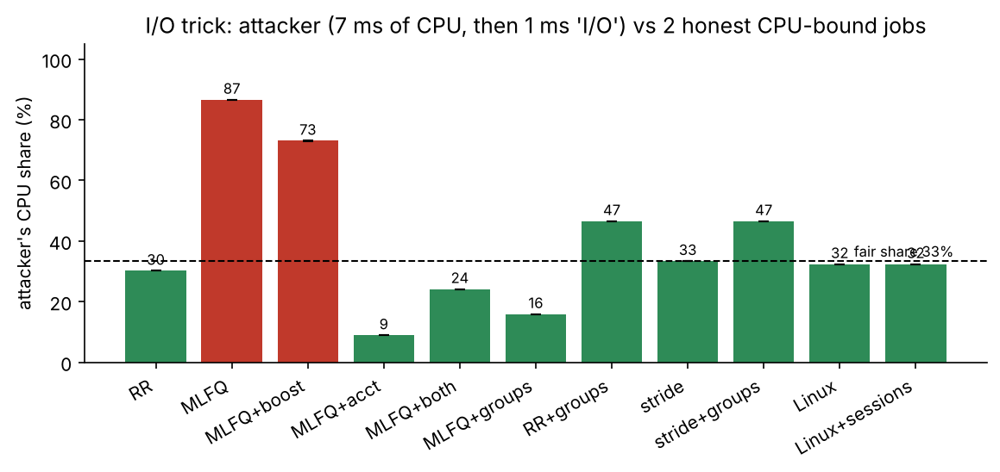
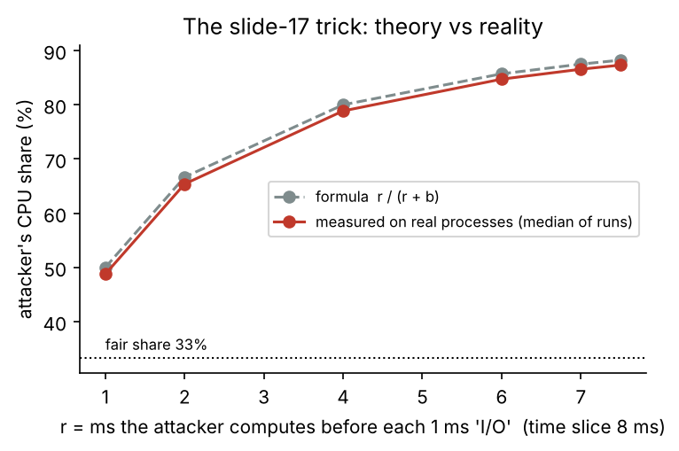
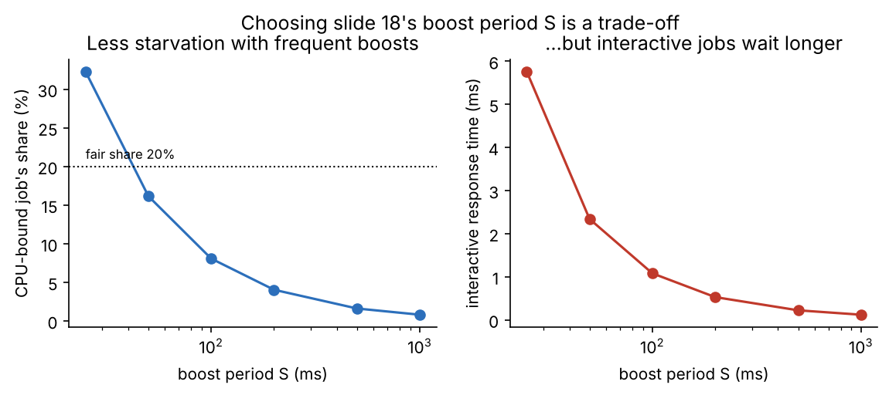
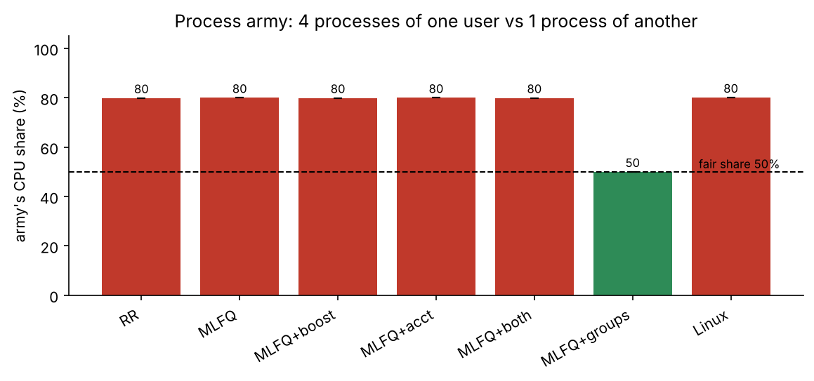
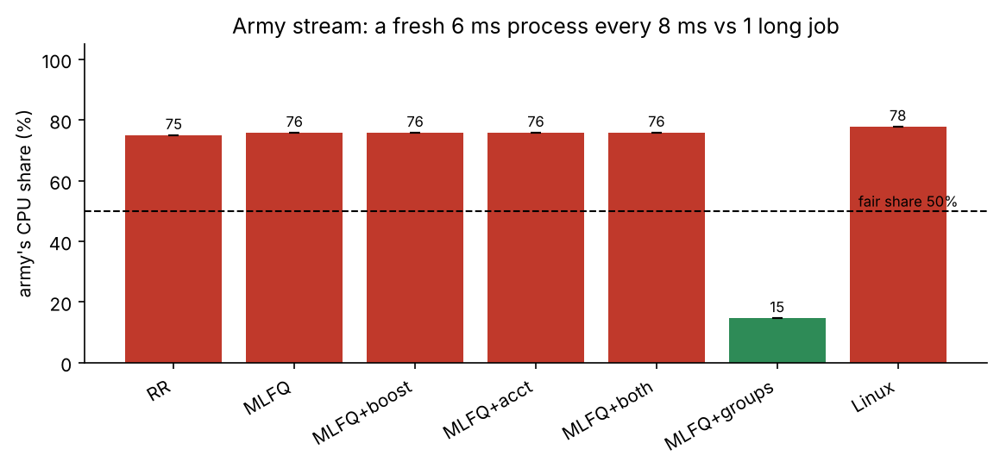
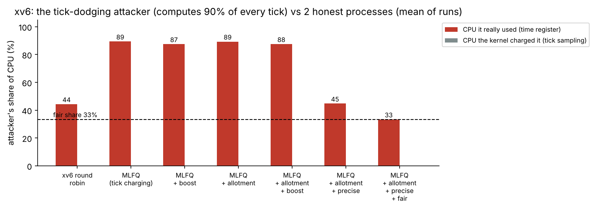
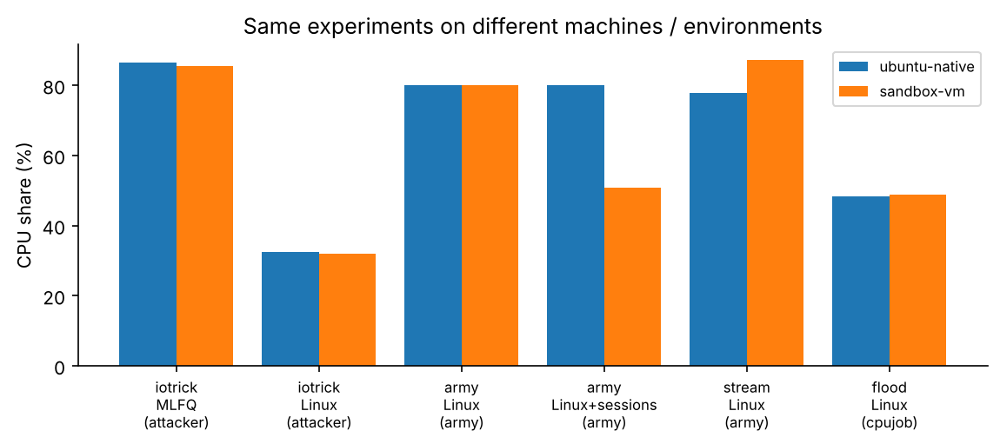
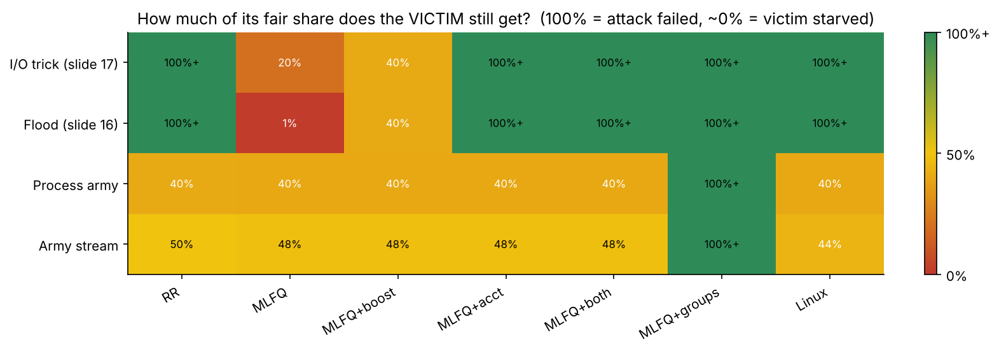

Code, data and scripts: <https://github.com/xtacy-on-code/fool-the-scheduler>

# Abstract

Lecture 7 states three things about the Multi-Level Feedback Queue (MLFQ): CPU-bound jobs can
starve (slide 16), a process can fool the scheduler by doing I/O just before its time slice
ends and use this for a denial-of-service attack (slide 17), and priority boosting plus
better accounting fix both problems (slide 18). These statements are normally only argued
on paper. This project tests them on real systems.

I built (1) a user-space scheduler that schedules real Linux processes with the lecture's MLFQ
and every fix as an on/off switch, (2) the same MLFQ inside the xv6 kernel, and (3) test
programs for Linux's and Windows' own schedulers. I then ran four attacks against all of them:
the slide-17 I/O trick, a slide-16 flood, a process army (one user, many processes)
and a tick dodge (running between timer ticks so that the kernel never charges you).

What I found: the slide-17 trick works as the slide says. Against the textbook MLFQ
the attacker takes 87\% of the CPU instead of its fair 33\%, within about
2 points of a simple formula. Better accounting stops it (9\%). Linux is
not fooled by it (32\%). But Linux is fooled by a process army: four processes
of one user take 80\% of the CPU from a single process of another user. Putting the
users in separate terminal sessions (autogroup) fixed this in a plain VM but not on a real Ubuntu
desktop (still 80\% for the army), because there systemd puts every process into a cgroup, which
overrides autogrouping. Separate cgroups alone did not help either; only cgroups with the CPU controller switched on brought the victim back to 51\%.
Inside xv6, the slide-18 fix does not work as long as CPU time is charged in whole timer ticks:
a tick-dodging attacker still gets 89\% of the CPU while being charged
almost nothing. Charging real elapsed time and ordering processes by CPU used (the idea behind
Linux's scheduler) brings it down to exactly 33.3\%.

# 1. Questions

* Q1. Does the slide-17 trick really work on a real MLFQ with real processes, and how much
  CPU can an attacker steal?
* Q2. Do the slide-18 fixes (priority boost, better accounting) stop it, and what do they cost?
* Q3. Are there other ways to cheat that the slides do not mention (process army, tick dodge)?
* Q4. Can the schedulers we use every day, Linux and Windows, be fooled?

# 2. Background

MLFQ (Lecture 7, slides 11-18). Several queues; queue $i$ has time slice $8 \cdot 2^{i}$ units
(8/16/32). New jobs enter the top queue. If $\mathrm{Priority}(A) > \mathrm{Priority}(B)$, $A$ runs;
equal priorities run round robin. A job that uses its whole slice drops one level; a job that
gives up the CPU early (I/O) stays. Slide 17 notes that this lets a process stay on top forever
by doing I/O just before its slice ends. Slide 18 proposes (a) boosting everyone to the top
every $S$ time units, and (b) better accounting: once a job has used its allotment at a level,
however many times it gave up the CPU, it is demoted.

Linux schedules threads with EEVDF (the successor of CFS, the red-black-tree scheduler on the
Lecture 6 slides). Every task has a virtual runtime: the CPU time it actually received, scaled by
its weight. The task that is most "owed" CPU runs next. With autogroup, every session (for
example every terminal) is a group, and CPU is first divided between groups.

Windows has 32 priority levels and gives a thread a temporary priority boost when it wakes up
from a wait, which is MLFQ-like behaviour (slide 11).

Tick accounting. A kernel that only looks at the CPU when the timer interrupt fires charges
the whole tick to whoever is running at that instant. A 2007 USENIX Security paper (Tsafrir,
Etsion and Feitelson, Secretly Monopolizing the CPU Without Superuser Privileges) showed
that a process which always sleeps across the tick is never charged. Our tick-dodge attack
re-tests this idea against an MLFQ inside xv6.

# 3. What I built

## 3.1 A scheduler for real processes (`src/usched.c`, `src/job.c`)

Linux normally decides which process runs. `usched` takes that decision away:

1. Every job is pinned to one CPU core (the textbook's uniprocessor). The scheduler itself
   runs on another core so its own work does not steal time from the jobs.
2. Every job is frozen with `SIGSTOP` except the one the policy picks, which gets `SIGCONT`.
   Linux only carries out our decisions.
3. Before an "I/O burst", a job writes `B <id> <ms>` into a pipe (fd 3) and sleeps. This plays the
   role of a blocking system call: the scheduler marks it BLOCKED and runs someone else.
4. The scheduler waits with `ppoll()` on that pipe and on a `signalfd` for `SIGCHLD`, with a timeout
   equal to the end of the time slice (or the next arrival / wake-up). Whatever happens first
   ends the slice: QUANTUM, BLOCK, EXIT or PREEMPT.
5. CPU time is measured with `clock_getcpuclockid()` (the job's real CPU clock), and with
   `wait4()`'s rusage when a job exits.

So the scheduler keeps the Lecture 3 process states (NEW, READY, RUNNING, BLOCKED, DONE) for real
processes. Policies: `rr`, `mlfq` (3 levels, 8/16/32 ms) with `-B S` (rule 5 boost), `-A`
(slide-18 accounting) and `-G` (account per user instead of per process: levels, allotments and
turns belong to the group), `stride` (proportional share, with `-G` for per-user tickets) and
`linux` (we do not schedule at all; `-S` puts each user in its own session). `-v` shows a live view
of the queues, used for the demo.

```c
kill(j->pid, SIGCONT);                      /* dispatch */
for (;;) {                                 /* wait for whatever ends the slice first */
    ...
    int r = ppoll(pf, 2, &tw, NULL);        /* pipe (I/O messages) + signalfd (exits) */
    if (r > 0 && (pf[1].revents & POLLIN) && check_children(j)) { why = "EXIT";  break; }
    if (r > 0 && (pf[0].revents & POLLIN) && read_messages(j))  { why = "BLOCK"; break; }
    admit_and_wake();
    if (should_preempt(j))                                      { why = "PREEMPT"; break; }
}
kill(j->pid, SIGSTOP);                      /* take the CPU back */
used = clk_ms(j->clk) - c_before;           /* CPU it really used in this slice */
charge(j, used, full_slice);                /* the policy: demote or not */
```

Workloads (`src/job.c`): an honest CPU-bound job, an interactive job (compute $b$ ms, I/O $io$ ms)
and the slide-17 attacker: compute $r$ ms (just under the slice), then do 1 ms of I/O, forever.

## 3.2 MLFQ inside xv6 (`xv6/`, about 250 changed lines)

xv6 normally switches process on every timer tick. I added:

* `kernel/proc.h`: per-process level, ticks charged, real CPU time (from the RISC-V `time`
  register), dispatch order, virtual runtime.
* `kernel/proc.c`: a new `scheduler()` that picks the highest queue (round robin inside it),
  `mlfq_tick()` which is called on every timer interrupt and decides whether the slice is over,
  demotion, rule-5 boost, and four switchable accounting modes (`SF_MLFQ`, `SF_ACCT`,
  `SF_PRECISE`, `SF_FAIR`).
* `kernel/trap.c`: the timer interrupt asks `mlfq_tick()` instead of always yielding; boosting.
* Three system calls: `schedctl(flags, boost)`, `pstat(pid, out)` and `rtime()`.
* `user/schedtest.c`: forks honest CPU hogs and a tick-dodging attacker: it sleeps across
  every tick (`pause(1)`), wakes right after it, computes for 90\% of a tick, and sleeps again
  before the next tick.

The tick is set to 10 ms and xv6 runs on one CPU in QEMU.

## 3.3 Windows (`windows/wintest.c`)

A native Windows program that pins competing processes to CPU 0 and measures the CPU each
really received (`QueryProcessCycleTime`, cycle-exact) and the CPU Windows reports
(`GetProcessTimes`, what Task Manager shows). It runs the I/O trick with three kinds of "I/O"
(`Sleep(1)`, waiting for an event completed by another thread, `SwitchToThread`), a process army,
and a tick dodge.

## 3.4 Setup

Main results: the author's laptop running native Ubuntu (ubuntu-native): Linux 7.0.0-28-generic,
13th Gen Intel(R) Core(TM) i9-13980HX, 32 logical CPUs, autogroup = 1.
Second machine (sandbox-vm): a 2-CPU cloud virtual machine, Linux 6.18.44-fc-v553, used during development.
Windows: the same laptop, Windows 11.
Every Linux run lasts 3 s and is repeated 3 times (error bars = standard deviation, mostly
below 1 point). xv6 tests last 3 s and are repeated 3 times.
"Fair share" is the share each process (or user) would get if the CPU were split equally.

# 4. Sanity check: the slide-13 example on real processes

Slide 13: P1 (arrives 0, needs 100 units) and P2 (arrives 40, needs 12), queues 8/16/32.
With 1 unit = 10 ms, the slide predicts P2 finishes at 520 ms and P1 at 1120 ms.

{ width=100% }

Measured: P2 finished at 520 ms and P1 at 1120 ms,
with the same order, the same preemption of P1 at 400 ms and the same queue levels. The extra
0.5 ms are the cost of the real signals and switches (on the 2-CPU VM it was
20 ms, because a virtual machine is not always given the CPU). The scheduler does what the slides say, so the attack results
below are about the policies, not about bugs.

# 5. Results

## 5.1 Attack 1: the I/O trick (slide 17)

One attacker (computes 7 ms, then 1 ms of "I/O") against two honest CPU-bound jobs. Fair share 33\%.

{ width=100% }

* Textbook MLFQ: the attacker takes 87\%. It never uses a full 8 ms slice, so it never
  leaves the top queue, and the honest jobs only run during its 1 ms of I/O. Slide 17 is right.
* Boost alone is not enough: 73\%. Every boost lifts the victims back to the top for
  a while, but the attacker is never demoted.
* Better accounting fixes it: 9\% (with boost: 24\%). The attacker is charged
  for its 7 ms bursts and sinks like everyone else. It even ends below fair, because at the
  bottom it gives up its 32 ms slice after 7 ms.
* RR (30\%), stride (33\%) and Linux (32\%) are not fooled: they
  never reward giving up the CPU. Linux charges each task for the CPU it actually used
  (virtual runtime), however often it sleeps. That is slide 18's "better accounting",
  already built into Linux.

Formula vs reality. If the attacker is never demoted, the honest jobs only run while it does I/O,
so its share should be $r/(r+b)$ with $b$ = 1 ms.

{ width=70% }

| $r$ (ms) | 1 | 2 | 4 | 6 | 7 | 7.5 |
|---|---|---|---|---|---|---|
| formula | 50.0 | 66.7 | 80.0 | 85.7 | 87.5 | 88.2 |
| measured (median) | 48.8 | 65.4 | 78.9 | 84.7 | 86.6 | 87.3 |

The measurement is consistently 1-2.5 points below the formula: every "I/O" costs the attacker
a real switch and a slightly longer sleep than requested, which the formula ignores.

## 5.2 Attack 2: flood (slide 16) and the boost period

A CPU-bound job against 4 interactive jobs that each compute 3 ms and wait 9 ms (together they
want 100\% of the CPU). Fair share for the CPU job: 20\%.

{ width=100% }

Under the textbook MLFQ the CPU job starves: 0.3\% on average (it varied from run to run,
on the VM it varied from run to run, see section 6). Linux gives it 48\%. Better accounting rescues it (72\%), but at a price
for the interactive jobs: their average response time grows from 0.1 ms to 28.4 ms,
because they get demoted too. Accounting with boost gives 24\% and 2.7 ms.

{ width=100% }

| boost period $S$ (ms) | 25 | 50 | 100 | 200 | 500 | 1000 |
|---|---|---|---|---|---|---|
| CPU job's share (\%) | 32.3 | 16.1 | 8.1 | 4.0 | 1.6 | 0.8 |
| interactive response (ms) | 5.76 | 2.34 | 1.08 | 0.53 | 0.22 | 0.12 |

This is the trade-off behind choosing $S$ (OSTEP calls such parameters "voo-doo constants"):
boosting every 25 ms gives the CPU job more than its fair share, but interactive jobs wait
48x longer than with $S$ = 1 s.

## 5.3 Attack 3: the process army

One user runs 4 CPU-bound processes, another runs 1. Per-user fair share: 50\%.

{ width=100% }

Every scheduler that is fair per process gives the army 4/5 = 80\%, including Linux
(80\%). MLFQ's fixes do not help, because the army does nothing suspicious: each of
its processes is an honest CPU hog. Only accounting per user stops it: MLFQ+groups
50\%, stride+groups 50\%.

Sessions vs cgroups on Linux. Linux's autogroup puts each session (e.g. each terminal) into its
own group and divides the CPU between groups first. On the 2-CPU VM, starting each user in its
own session (`setsid`) gave the army only 51\%. On the real Ubuntu laptop
it changed nothing: 80\%. The reason is in `sched(7)`: placing processes in cgroups with
the CPU controller "overrides the effect of autogrouping", and a systemd desktop places every
process in a cgroup. So on a modern desktop the defense is cgroups. I tested this directly with `scripts/cgroup_army.py` (1 victim process vs a 4-process army, CPU 0, 3 runs each):

| setup | victim's share |
|---|---|
| both users in the same cgroup (default terminal) | 20.0\% |
| each user in its own cgroup (`systemd-run --user --scope`) | 20.1\% |
| each user in its own cgroup with the CPU controller on (`-p CPUWeight=100`) | 50.5\% |

Separate cgroups alone changed nothing. The reason was in `/sys/fs/cgroup`: the `app.slice` group
listed only `memory pids` in its `cgroup.subtree_control`, so its child cgroups were not scheduled
as groups. Asking for a CPU weight made systemd add `cpu` there, and the CPU was then split per
cgroup: exactly fair.

Army stream. A smarter army keeps creating fresh 6 ms processes (one every 8 ms), because
"a new job enters at the highest priority queue" (slide 12).

{ width=100% }

The stream takes about 76\% under every per-process policy and 78\% under Linux. Per-user accounting stops it: stride+groups
43\% (Linux with sessions: 52\% on the VM, 78\% on the laptop). MLFQ+groups even over-corrects
(15\%): users take turns, and one turn of the army is a single 6 ms process
while one turn of the victim is a full 32 ms slice.

## 5.4 Attack 4: the tick dodge, inside xv6

Two honest CPU hogs and one attacker that computes during 90\% of every 10 ms tick and is
always asleep when the tick arrives. Fair share 33\%.

{ width=100% }

| xv6 scheduler | attacker's real CPU | charged by ticks |
|---|---|---|
| xv6 round robin | 44.3\% | 0.0\% |
| MLFQ (tick charging) | 89.4\% | 0.0\% |
| MLFQ + boost | 87.4\% | 0.0\% |
| MLFQ + allotment | 89.3\% | 0.0\% |
| MLFQ + allotment + boost | 87.5\% | 0.0\% |
| MLFQ + allotment + precise | 44.7\% | 0.0\% |
| MLFQ + allotment + precise + fair | 33.3\% | 0.0\% |

* Plain xv6 already loses: the attacker gets 44.3\% while being charged 0.0\%.
  Whoever runs in the last instant before a tick is billed a whole tick, so one honest process is
  billed for time the attacker used.
* MLFQ with tick charging is fooled completely: the attacker is never seen running, so it is
  never demoted: 89\% (runs: 89-90\%). The more of each tick it uses,
  the more it gets: 50\% of a tick -> 50\%, 80\% of a tick -> 79\%, 90\% of a tick -> 89\%, 95\% of a tick -> 94\%.
* Slide 18's fix does not work here. Allotment accounting counts ticks, and the attacker has
  none: 89\%. Adding the boost does not help either (88\%).
  So better accounting only helps if the accounting itself is accurate.
* Precise accounting (charging real elapsed time from the `time` register at every switch)
  demotes the attacker to the bottom queue: 45\%. Not fully fair yet: inside the
  bottom queue, round-robin order still favours a process that wakes up right after every tick.
* Precise accounting + fair order inside a queue (run the process that has used the least CPU,
  that is, virtual runtime): 33.3\%, which is fair. Linux does basically the same thing.

Even then, the tick-sampled statistics still show the attacker at about 0\% CPU: a monitor built on
tick sampling (like old versions of `top`) would never see it.

## 5.5 Linux and Windows

Linux was covered above: it resists the I/O trick and the flood, but not a process army unless
users are in separate cgroups. Windows was measured on the author's laptop with `wintest.exe`.

Windows.

Machine: windows 10.0 build 26200, tick 15.625 ms, Sleep(1) 14.887 ms, 2412757 cycles/ms.

* The I/O trick fails on Windows. With every kind of "I/O" (`Sleep`, an event completed by another
  thread, `SwitchToThread`) and every run length, the attacker got at most 44\%, never more
  than the 50\% fair share. The longer it runs before giving up the CPU, the more it gets
  (7\% at 2 ms, 31\% at 25 ms with `Sleep`): giving up the CPU is simply
  lost time. Windows' wake-up boosts did not turn into an advantage.
* The process army works on Windows too: 4 processes took 78\% (per-process
  fairness would give 80\%). Like Linux, Windows is fair per thread, not per user.
* The tick dodge fails on Windows. The dodger got only 22\% against an honest
  process, and Windows' reported CPU time matched the real cycles: running alone, the dodger really
  used 4214 ms and Windows reported 4141 ms. Windows does not charge by sampling
  ticks, so the 2007 attack no longer works on it.
* Default timer: 15.625 ms per tick, `Sleep(1)` really sleeps about 14.9 ms. That is why a
  process that sleeps even 1 ms gives away a whole tick, and why short runs got so little.


{ width=100% }

| test | group | real CPU share | reported CPU share |
|---|---|---|---|
| baseline 2 hogs | hogA | 48.5\% | 46.5\% |
| baseline 2 hogs | hogB | 51.5\% | 53.5\% |
| iotrick sleep run2ms | honest | 92.6\% | 93.5\% |
| iotrick sleep run2ms | attacker | 7.4\% | 6.5\% |
| iotrick event run2ms | honest | 92.9\% | 93.6\% |
| iotrick event run2ms | attacker | 7.1\% | 6.4\% |
| iotrick yield run2ms | honest | 92.8\% | 93.9\% |
| iotrick yield run2ms | attacker | 7.2\% | 6.1\% |
| iotrick sleep run10ms | honest | 78.8\% | 79.0\% |
| iotrick sleep run10ms | attacker | 21.1\% | 21.0\% |
| iotrick event run10ms | honest | 75.0\% | 77.4\% |
| iotrick event run10ms | attacker | 25.0\% | 22.6\% |
| iotrick yield run10ms | honest | 75.5\% | 73.5\% |
| iotrick yield run10ms | attacker | 24.5\% | 26.5\% |
| iotrick sleep run25ms | honest | 68.6\% | 69.1\% |
| iotrick sleep run25ms | attacker | 31.4\% | 30.9\% |
| iotrick event run25ms | honest | 64.0\% | 65.1\% |
| iotrick event run25ms | attacker | 36.0\% | 34.9\% |
| iotrick yield run25ms | honest | 56.2\% | 56.6\% |
| iotrick yield run25ms | attacker | 43.8\% | 43.4\% |
| army 4 vs 1 | victim | 22.3\% | 22.2\% |
| army 4 vs 1 | army | 77.7\% | 77.8\% |
| tickdodge 50pct | honest | 84.1\% | 87.2\% |
| tickdodge 50pct | dodger | 15.9\% | 12.8\% |
| tickdodge 80pct | honest | 79.4\% | 78.4\% |
| tickdodge 80pct | dodger | 20.6\% | 21.6\% |
| tickdodge 90pct | honest | 78.0\% | 77.2\% |
| tickdodge 90pct | dodger | 22.0\% | 22.8\% |
| tickdodge alone 90pct | dodger | 100.0\% | 100.0\% |


## 5.6 The same experiments on different machines

{ width=95% }

The shape of the results is the same on both Linux machines, with one exception: separate sessions
protect against the process army only in the VM (section 5.3).


## 5.7 The whole picture

Each cell shows how much of its fair share the victim still gets (100\% = the attack failed;
for the "+groups" and "+sessions" columns fairness is per user).

{ width=100% }

| | I/O trick | flood | process army | tick dodge |
|---|---|---|---|---|
| textbook MLFQ | fooled | starves | fooled | fooled (xv6) |
| MLFQ + boost | partly | partly | fooled | fooled (xv6) |
| MLFQ + better accounting | safe | safe, slower interaction | fooled | fooled if charged by ticks |
| per-user accounting | safe | safe | safe | - |
| precise + fair order | - | - | - | safe (xv6) |
| Linux (EEVDF) | safe | safe | fooled (safe only with per-user cgroups + CPU controller) | safe (precise accounting) |
| Windows | safe | - | fooled | safe |

# 6. Problems and surprises

Things that went wrong or surprised me while building and measuring:

1. My first army results were wrong. Short processes usually finish inside their slice, and
   my first version only charged a job when its slice ended, never when it exited. So the army
   stream looked unbeatable even with per-user accounting. Fix: also charge on exit, using the
   exit rusage (`wait4`).
2. Per-user levels were not enough. My first MLFQ+groups still gave the army 80\%: the
   army's processes shared one level, but inside a level the round robin was still per process.
   Fix: inside a level, users take turns (`last_run` per group). That is the 50\% in 5.3.
3. In xv6, precise accounting alone did not give 33\%. The attacker got 45\% and one honest
   process starved at a few percent, although both honest processes were charged the same number
   of ticks (but 5.8\% vs
   49.4\% real CPU in one run). The test's own parent sleeps on the tick channel, wakes on every
   tick and preempts the running process; with round robin, the slot right after the attacker
   always went to the same honest process, which then only ran about 1 ms before the next tick
   but was billed for the whole tick. Ordering by CPU used inside a queue (`SF_FAIR`) fixed it.
4. Sessions protected the victim in the VM but not on my laptop. I first tested the army on
   the 2-CPU VM, where separate sessions gave 50/50, and expected the same on Ubuntu. On the
   laptop the victim still got 20\%. Reading `sched(7)` explained it: systemd's cgroups
   override autogroup. My first cgroup test then failed too (victim 20\% with separate cgroups), until
   I found that the `cpu` controller was not enabled for those cgroups (section 5.3).
5. The attacker cannot be too greedy (on the VM). On the VM, an xv6 attacker computing 90-95\% of
   every tick was sometimes caught by a slightly late tick, demoted, and fell to about 50\%
   (runs at 95\%: 58, 56, 92\%). On the laptop's native QEMU the ticks were
   punctual and it was never caught (94, 94, 95\%).
6. The VM was noisy, the laptop was not. On the VM, the flood under the textbook MLFQ gave the CPU
   job anything from 0.3\% to 15\% between runs, and in one run of the sweep the attacker ($r$ = 4 ms)
   fell to 21\% instead of about 78\%. Its event log shows why: in one 8 ms slice it received only
   4.0 ms of CPU, because the VM itself was not running, so `usched` thought the slice was used up and
   demoted it. `usched` measures slices in wall-clock time; a real kernel counts the time the process
   actually ran. On the laptop all 3 runs of every test agreed within a few tenths of a percent.
7. One measurement I could not reproduce. An early version of the session test on the VM gave
   all-or-nothing results (one side 100\%). A cleaner version (one session leader per user)
   always gave about 50/50 there, so I used the clean version.
8. Linux and the army stream. The stream got 78\% on the laptop but 87\% on the VM. I have
   not fully explained the VM number; one cost that is counted for the army under Linux is that
   every new process `exec`s the job program on the same core.
9. Porting xv6. The current xv6-riscv renamed `sleep` to `pause` and changed `copyout`'s
   arguments, so code written for older xv6 versions did not compile as is.

# 7. Limitations

* `usched` is a user-space scheduler: it reacts to signals and messages, not to hardware
  interrupts, and its decisions take microseconds instead of nanoseconds. Section 4 shows the
  effect is about 1\%.
* Only one CPU core; multicore load balancing opens other attacks that are not covered.
* The jobs announce their I/O; a kernel learns this from the blocking system call itself.
* Linux numbers come from one laptop (and a VM during development); other kernels and desktops may differ.

# 8. Conclusion

* Slide 17 is right: the textbook MLFQ is fooled by the I/O trick (87\% for the attacker)
  and starves CPU-bound jobs.
* Slide 18's fixes work, with two conditions: accounting must be precise (a tick-based
  kernel like xv6 is still fooled), and accounting must be per user (otherwise a process army
  wins under every policy, including Linux).
* Windows behaves like Linux: safe against the I/O trick and the tick dodge, fooled by a process army.
* Linux is safe against the I/O trick because virtual runtime is precise accounting, but it is
  fair per process, not per user. Against armies, autogroup worked in a VM but is overridden by
  systemd's cgroups on a real desktop, and cgroups only help once their CPU controller is switched on.
* A complete fix inside xv6 needed four things together: MLFQ levels, allotment accounting,
  precise time and fair ordering. That combination ends up looking a lot like Linux's scheduler.

Future work: a detector that flags processes with "suspicious" CPU patterns, attacks on
multicore load balancing, and repeating the Windows tests on more Windows versions.

# References

1. Lecture 6 (Process Scheduling) and Lecture 7 (CPU Time-share Scheduling), CSL301, IIT Bhilai.
2. R. and A. Arpaci-Dusseau, Operating Systems: Three Easy Pieces, ch. 7-9 (scheduling, MLFQ, proportional share).
3. D. Tsafrir, Y. Etsion, D. Feitelson, "Secretly Monopolizing the CPU Without Superuser Privileges", USENIX Security 2007.
4. C. Waldspurger, W. Weihl, "Stride Scheduling: Deterministic Proportional-Share Resource Management", MIT TR, 1995.
5. Linux kernel documentation, "EEVDF Scheduler" and `sched(7)` (autogroup).
6. M. Russinovich et al., Windows Internals, chapter on thread scheduling and priority boosts.
7. MIT PDOS, xv6-riscv, <https://github.com/mit-pdos/xv6-riscv>.

# Appendix: how to reproduce

```bash
make
python3 scripts/run_linux.py <machine-name>      # all Linux experiments (~10 min)
python3 scripts/run_xv6.py   <machine-name>      # xv6 in QEMU (~6 min)
python3 scripts/analyze.py   <machine-name>      # figures + numbers.json
python3 scripts/build_report.py <machine-name>   # this report
./usched -p mlfq -v -T 6000 workloads/iotrick.txt   # live demo
```
