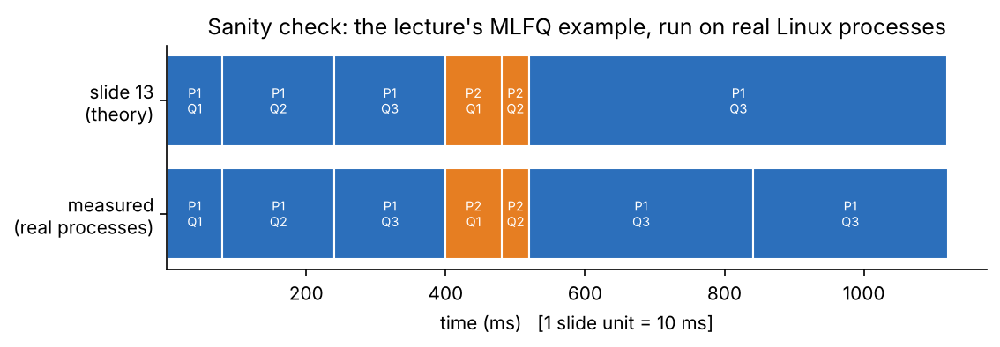
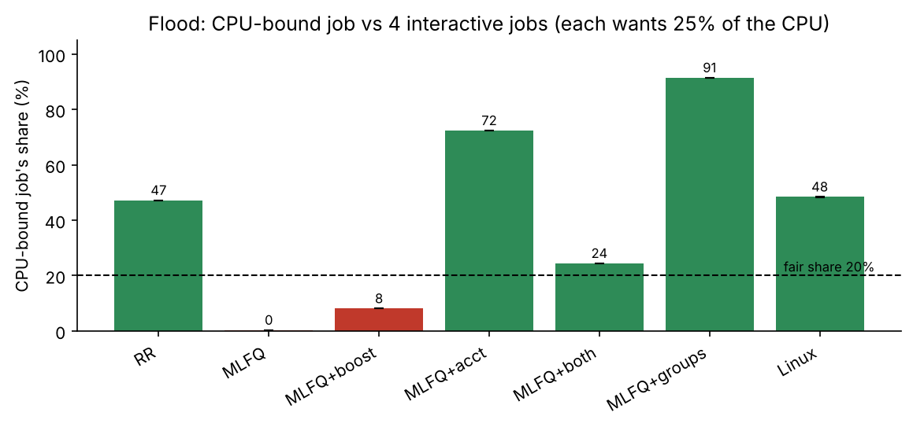
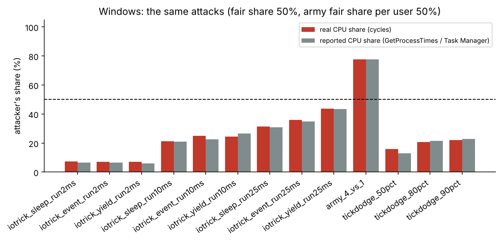

Code and data: <https://github.com/xtacy-on-code/fool-the-scheduler>

# Abstract

In Lecture 7 we saw that MLFQ can be fooled: a process that does I/O just before its time slice
ends stays in the top queue forever (slide 17), CPU-bound jobs can starve (slide 16), and priority
boost plus better accounting are supposed to fix this (slide 18). I wanted to see if this really
happens on real processes and not only on paper. I wrote a small scheduler that controls real
Linux processes using signals, added the same MLFQ to the xv6 kernel, and tried the same attacks
on Linux and Windows on my laptop.

The attack works: on the lecture's MLFQ the attacker got 87\% of the CPU when its fair share is
33\%. Better accounting brings it down to 9\%. Linux (32\%) and Windows (at most 44\%) were not
fooled by this trick. But both of them can be beaten by just starting many processes: 4 processes
of one user got 80\% of the CPU on Linux and 78\% on Windows. In xv6, where time is counted
in timer ticks, the slide-18 fix did not help at all (89\% for the attacker) until I changed
the kernel to count real time.

# 1. Introduction

The scheduler decides who gets the CPU. MLFQ tries to guess which processes are interactive by
watching whether they give up the CPU early. The slides themselves say this guess can be abused.
My questions were:

1. Does the slide-17 trick really work on real processes, and how much CPU can the attacker get?
2. Do the slide-18 fixes (boost and better accounting) stop it?
3. Are there other simple ways to cheat?
4. Can Linux and Windows be fooled the same way?

# 2. What I built

## 2.1 usched: a scheduler for real processes

I could not change the Linux kernel's scheduler, so I wrote a normal program, `usched`, that acts
as the scheduler for a group of child processes (`src/usched.c`, `src/job.c`):

* All jobs are pinned to CPU 0 with `sched_setaffinity`, so there is only one CPU like in our examples.
* Every job is stopped with `SIGSTOP`. The job that the policy picks gets `SIGCONT`, runs for its time
  slice, and is stopped again. So Linux only runs the process that my scheduler chose.
* When a job wants to do "I/O" it first writes a short message into a pipe and then sleeps.
  `usched` reads it and marks the job BLOCKED. This is like a system call telling the kernel.
* `usched` waits with `ppoll()` on the pipe and on SIGCHLD, with a timeout equal to the time slice.
  Whatever happens first ends the slice: time slice over, job blocked, or job exited.
* The CPU time each job really used is read with `clock_getcpuclockid()`.

So each job goes through the states from Lecture 3 (ready, running, blocked, done). The policies are
round robin and the MLFQ from the slides (3 queues, slices 8, 16 and 32 ms) with options for the
priority boost (`-B`), better accounting (`-A`) and counting CPU per user instead of per process
(`-G`). There is also a `linux` mode where `usched` does not schedule at all and Linux decides.

```c
kill(j->pid, SIGCONT);                 /* run the chosen job */
int r = ppoll(pf, 2, &tw, NULL);       /* wait: io message, exit, or slice over */
...
kill(j->pid, SIGSTOP);                 /* take the CPU back */
used = clk_ms(j->clk) - c_before;      /* cpu it really used */
charge(j, used, full_slice);           /* demote or not */
```

The jobs are: an honest CPU-bound job, an interactive job (compute a bit, then I/O), and the
attacker from slide 17 (compute 7 ms of its 8 ms slice, then 1 ms of I/O, forever).

## 2.2 MLFQ in xv6

Our lectures are based on xv6, so I also added the MLFQ to the xv6 kernel (RISC-V version):

* `proc.h`: each process gets a queue level and counters for CPU time.
* `trap.c`: on a timer interrupt the process only gives up the CPU if its slice is used up
  (normal xv6 switches on every tick).
* `proc.c`: `scheduler()` picks the highest queue first, round robin inside a queue, plus boost.
* Three new system calls: `schedctl()` to choose the policy, `pstat()` to read a process's
  statistics and `rtime()` to read the time.
* `user/schedtest.c`: starts two CPU hogs and one attacker.

xv6 only notices time on timer ticks (I set them to 10 ms). The attacker uses this: it sleeps
across every tick and runs only between ticks, so it is never running when a tick happens. If CPU
time is counted per tick, it is never charged.

## 2.3 Windows

`windows/wintest.c` starts the same kind of processes on CPU 0 and measures how much CPU each got,
using the exact cycle counter and also what Windows reports (the numbers Task Manager uses).

## 2.4 Setup

Laptop: 13th Gen Intel(R) Core(TM) i9-13980HX, native Ubuntu with Linux 7.0.0-28-generic, and Windows 11 on the same laptop.
I also used a small cloud VM while developing. Each test runs for 3 seconds and is repeated 3 times;
on the laptop the 3 runs almost always agreed within 0.2\%. Fair share means splitting the CPU
equally between the processes (or users).

# 3. Checking that usched works

Before attacking anything I ran the example from slide 13 (P1 arrives at 0 and needs 100 units,
P2 arrives at 40 and needs 12, queues 8/16/32, with 1 unit = 10 ms). The slide says P2 finishes at
520 ms and P1 at 1120 ms. With real processes P2 finished at 520.3 ms and P1 at 1120.5 ms, in
the same order and with the same preemption.

{ width=100% }

# 4. Results

## 4.1 The I/O trick (slide 17)

One attacker against two honest CPU-bound jobs. Fair share is 33\%.

{ width=100% }

* MLFQ from the slides: the attacker gets 87\%. It never uses a full slice, so it never moves
  down, and the honest jobs only run during its 1 ms of I/O. So slide 17 is correct.
* Boost alone: 73\%. It lifts the honest jobs up for a short time but the attacker is never demoted.
* Better accounting: 9\%. Now its 7 ms pieces are added up and it moves down like everyone else.
* Round robin (30\%) and Linux (32\%) are not fooled, because giving up the CPU early does not
  give any advantage there. Linux keeps track of how much CPU each process actually used.

I also checked it with a simple formula: if the attacker runs $r$ ms and then does 1 ms of I/O, and
never moves down, it should get $r/(r+1)$ of the CPU.

| $r$ (ms) | 1 | 2 | 4 | 6 | 7 | 7.5 |
|---|---|---|---|---|---|---|
| formula (\%) | 50.0 | 66.7 | 80.0 | 85.7 | 87.5 | 88.2 |
| measured (\%) | 48.8 | 65.4 | 78.9 | 84.7 | 86.6 | 87.3 |

The measured values are 1-2 points lower because every I/O also costs a switch.

## 4.2 Starvation (slide 16) and the boost

One CPU-bound job against 4 interactive jobs (each computes 3 ms, then waits 9 ms).

{ width=100% }

With the plain MLFQ the CPU-bound job gets only 0.3\%: it starves, as slide 16 says. Better accounting
saves it (72\%), but the interactive jobs then get demoted too and have to wait longer.
The boost period matters a lot:

| boost (ms) | 25 | 50 | 100 | 200 | 500 | 1000 |
|---|---|---|---|---|---|---|
| CPU job (\%) | 32.3 | 16.1 | 8.1 | 4.0 | 1.6 | 0.8 |
| interactive wait (ms) | 5.76 | 2.34 | 1.08 | 0.53 | 0.22 | 0.12 |

Boosting often helps the CPU-bound job but makes the interactive jobs wait longer, so there is no
perfect value.

## 4.3 Many processes (process army)

Here nothing is tricky: one user just starts 4 CPU-bound processes, the other user has 1.

{ width=100% }

Every scheduler that is fair per process gives the 4 processes 80\% (4 out of 5), and Linux too
(80\%). Only counting CPU per user (`-G`) gives the victim back its half (50\%).

On Linux I tried two things to separate the users:

* Separate terminal sessions: in the VM this gave 50/50, but on my Ubuntu laptop it did not
  change anything (still 80\% for the army).
* Separate cgroups (`systemd-run --user --scope`): with both users in the same cgroup the victim got 20\%, in separate cgroups still 20\%. The reason was that the cgroup `cpu` controller was not switched on for them. With `-p CPUWeight=100` systemd switches it on, and then the victim got 51\%.

## 4.4 The tick dodge in xv6

Two CPU hogs and one attacker that runs 90\% of every tick but sleeps when the tick comes.

{ width=100% }

| xv6 scheduler | attacker real CPU | CPU charged by ticks |
|---|---|---|
| xv6 round robin | 44.3\% | 0.0\% |
| MLFQ (tick charging) | 89.4\% | 0.0\% |
| MLFQ + boost | 87.4\% | 0.0\% |
| MLFQ + allotment | 89.3\% | 0.0\% |
| MLFQ + allotment + boost | 87.5\% | 0.0\% |
| MLFQ + allotment + precise | 44.7\% | 0.0\% |
| MLFQ + allotment + precise + fair | 33.3\% | 0.0\% |

* Even normal xv6 gives the attacker 44\% and charges it almost nothing.
* With the MLFQ, the attacker is never seen running at a tick, so it never moves down: 89\%.
* The slide-18 fix also fails here (89\%), because the allotment is also counted in ticks.
* When I changed xv6 to charge the real time (read from the RISC-V time register at every switch),
  the attacker moved to the lowest queue (45\%). It was still a bit more than fair, so I also
  made the scheduler pick the process that used the least CPU inside a queue. Then all three got
  33.3\%.

## 4.5 Windows

* The I/O trick did not work: the attacker never got more than 44\% (fair share 50\%).
* 4 processes against 1 got 78\%, same as Linux.
* The tick dodge did not work either, and the CPU time Windows reported matched the real cycles
  (the dodger really used 4214 ms and Windows showed 4141 ms).

{ width=100% }

## 4.6 Summary

| | I/O trick | starvation | process army | tick dodge |
|---|---|---|---|---|
| MLFQ from the slides | fooled | starves | fooled | fooled (xv6) |
| MLFQ + boost | partly | partly | fooled | fooled (xv6) |
| MLFQ + better accounting | ok | ok, interactive slower | fooled | fooled if counted in ticks |
| per-user accounting | ok | ok | ok | - |
| Linux | ok | ok | fooled (ok with cgroups + CPU controller) | ok |
| Windows | ok | - | fooled | ok |

# 5. Problems I ran into

1. My first results for the process army were wrong. Short jobs usually finish inside their slice
   and I only charged CPU at the end of a slice, not when a job exited. Fixed by also charging on exit.
2. My first per-user version still gave the army 80\%: the levels were per user but inside a queue
   it was still round robin per process. I had to make users take turns.
3. In xv6, after switching to real-time charging, one honest process almost starved. Every tick
   wakes up the waiting test program, which preempts the running process, and the round-robin order
   kept giving the slot after the attacker to the same process. Picking the process with the least
   CPU fixed it.
4. The cloud VM sometimes did not run my process for a few milliseconds, so `usched` thought a
   slice was used up and demoted the attacker by mistake. On the laptop this did not happen.
5. Separate sessions worked in the VM but not on my laptop, and separate cgroups first did not
   work either, until I found the `cpu` controller was not enabled for them.
6. The newest xv6 renamed `sleep` to `pause` and changed `copyout`, so I had to adjust my code.

# 6. Limitations

* `usched` runs in user space and the jobs tell it about their I/O; a real kernel sees the system call.
* Only one CPU.
* The Linux results come from one laptop; other kernels or desktops may behave differently.

# 7. Conclusion

Slide 17 is right: the MLFQ from the lecture can be fooled (87\% for the attacker), and slide 16's
starvation also happens. The slide-18 fixes work, but only if CPU time is counted properly: in xv6
with tick counting they did nothing. Linux and Windows are not fooled by the I/O trick, but both
give more CPU to a user who simply starts more processes, unless the system groups processes per user.

# References

1. Lecture 6 and Lecture 7 slides, CSL301, IIT Bhilai.
2. R. and A. Arpaci-Dusseau, Operating Systems: Three Easy Pieces, chapters 7 and 8.
3. D. Tsafrir, Y. Etsion, D. Feitelson, "Secretly Monopolizing the CPU Without Superuser Privileges", USENIX Security 2007 (idea for the tick dodge).
4. xv6-riscv, MIT PDOS, <https://github.com/mit-pdos/xv6-riscv>.
5. Linux man pages `sched(7)`, `cgroups(7)`.

# Appendix: how to run

```bash
make
./usched -p mlfq -v -T 6000 workloads/iotrick.txt   # watch the attacker win
./usched -p mlfq -A -v -T 6000 workloads/iotrick.txt   # and lose with accounting
python3 scripts/run_linux.py <name>                    # all Linux tests
python3 scripts/run_xv6.py <name>                      # xv6 tests (qemu)
python3 scripts/analyze.py <name>                      # graphs
```
